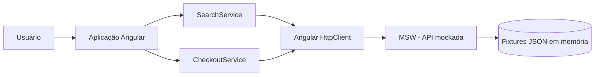
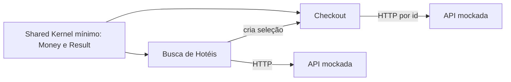
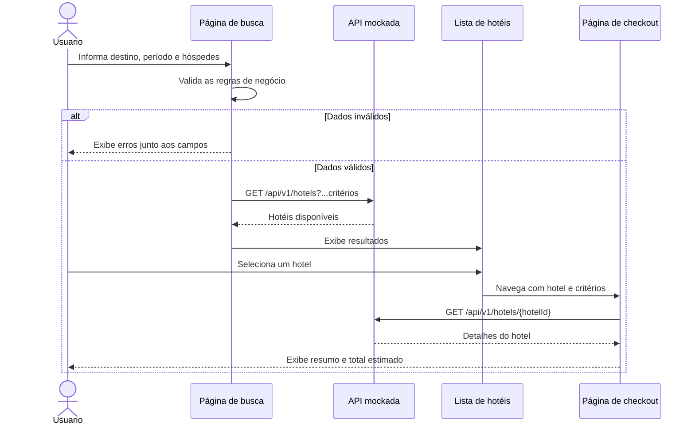

# Arquitetura da PoC de reservas de hotéis

## 1. Contexto e objetivo

Esta solução é uma prova de conceito para validar a jornada de busca e início de reserva de hotéis. O usuário deve conseguir:

1. informar destino, período e quantidade de hóspedes;
2. consultar hotéis disponíveis;
3. selecionar um hotel;
4. avançar para a tela de checkout.

O escopo usa dados mockados, não confirma reservas reais, não processa pagamentos e não integra parceiros externos.

### Regras de negócio

- Destinos aceitos: Rio de Janeiro, Goiás e Brasília.
- A data de entrada deve ser igual ou posterior à data atual.
- Reservas para o próprio dia são permitidas.
- A data de saída deve ser posterior à data de entrada.
- Deve haver pelo menos 1 adulto.
- A quantidade mínima de crianças é 0.
- A busca somente é executada após a validação de todos os campos.

### Premissas

- A busca usa um período composto por `checkIn` e `checkOut`, embora o contexto original mencione apenas “data”.
- “Checkout” significa a tela de revisão da reserva, sem cobrança ou confirmação.
- Não haverá autenticação, cadastro, persistência permanente nem dados reais de hóspedes nesta PoC.
- Valores serão exibidos em BRL e datas seguirão o calendário local do Brasil.
- A disponibilidade retornada pelo mock é apenas demonstrativa.

### Fora do escopo

- pagamento;
- emissão de voucher;
- confirmação com hotel ou fornecedor;
- cancelamento e alteração;
- login e área do cliente;
- painel administrativo;
- persistência em banco de dados.

## 2. Estilo arquitetural

Recomenda-se uma **Single Page Application Angular organizada por features**, com uma camada de mock HTTP executada no navegador por **Mock Service Worker (MSW)**.

Essa arquitetura é suficiente para validar navegação, regras, estados de tela e contratos de API sem o custo operacional de backend e banco de dados. As interfaces HTTP preservam um caminho simples para substituir os mocks por uma API .NET no futuro.



### Localização do código de frontend

Todo código ligado ao frontend deve ficar na pasta `/src/frontend`. Isso inclui:

- código-fonte Angular (`src/app`, `main.ts`, `index.html`, estilos e assets);
- configuração de ferramentas: `package.json`, `yarn.lock`, `angular.json`, `tsconfig*.json`, `eslint.config.js` e `.editorconfig` específico do frontend;
- mocks MSW, fixtures e o arquivo `mockServiceWorker.js` publicado;
- testes unitários, de componentes, de integração e end-to-end, incluindo `playwright.config.ts`;
- scripts e ferramentas auxiliares do frontend, como verificações arquiteturais;
- artefatos gerados (`node_modules`, `dist`, `.angular`, relatórios de teste), que também não devem ser versionados.

Comandos Yarn e Angular CLI são executados a partir de `/src/frontend`. A raiz do repositório e as demais pastas de `/src` ficam reservadas para documentação, configurações globais do repositório e uma eventual API .NET futura (seção 12), que não deve ser misturada ao frontend.

```text
/
├── aula 2/                 # documentação de arquitetura
└── src/
    └── frontend/
        ├── package.json
        ├── yarn.lock
        ├── angular.json
        ├── tsconfig.json
        ├── eslint.config.js
        ├── playwright.config.ts
        ├── public/
        ├── e2e/
        ├── tools/
        └── src/
            └── app/        # organização lógica abaixo
```

### Organização lógica

O caminho abaixo é relativo à raiz do repositório.

```text
/src/frontend/src/app/
├── core/
│   ├── api/
│   ├── errors/
│   └── observability/
├── features/
│   ├── hotel-search/
│   │   ├── domain/
│   │   ├── data-access/
│   │   └── pages/
│   └── checkout/
│       ├── domain/
│       ├── data-access/
│       └── pages/
├── shared/
│   ├── components/
│   └── validators/
└── mocks/
    ├── handlers/
    └── fixtures/
```

As páginas dependem de serviços de aplicação e modelos do domínio, não diretamente dos detalhes do MSW. Componentes compartilhados devem se limitar a elementos realmente reutilizáveis, como loading, mensagem de erro e resumo de preço.

## 3. Domínio e fronteiras

Para a PoC, os contextos abaixo são módulos do mesmo frontend, e não serviços independentes.

### Contexto de Busca de Hotéis

**Responsabilidades**

- receber e validar os critérios;
- consultar o catálogo mockado;
- listar hotéis e estados de carregamento, vazio e erro;
- manter a seleção do hotel.

**Entidades e objetos de valor**

- `Hotel`: identificador, nome, destino, imagem, avaliação, preço da diária e comodidades;
- `SearchCriteria`: destino, check-in, check-out, adultos e crianças;
- `Destination`: código e nome de exibição;
- `Money`: valor e moeda.

**Invariantes**

- destino pertence ao catálogo permitido;
- `checkIn >= hoje`;
- `checkOut > checkIn`;
- `adults >= 1`;
- `children >= 0`.

### Contexto de Checkout

**Responsabilidades**

- receber hotel e critérios selecionados;
- apresentar resumo da estadia;
- calcular quantidade de noites e preço total estimado;
- impedir acesso sem uma seleção válida.

**Modelo**

- `BookingDraft`: hotel selecionado, período, hóspedes, quantidade de noites e total.

O `BookingDraft` é transitório. Um recarregamento direto da rota pode reconstruí-lo pelos parâmetros de navegação ou redirecionar o usuário para a busca.

### Dependências



## 4. Jornada principal



### Estados obrigatórios da interface

- formulário inicial;
- validação de campos;
- carregamento;
- resultados encontrados;
- nenhum resultado;
- erro simulado de API;
- checkout válido;
- seleção expirada ou inválida.

## 5. Contratos das APIs mockadas

### Listar destinos

`GET /api/v1/destinations`

```json
{
  "status": "success",
  "message": "Destinos encontrados.",
  "data": [
    { "code": "RIO", "name": "Rio de Janeiro" },
    { "code": "GO", "name": "Goiás" },
    { "code": "BSB", "name": "Brasília" }
  ],
  "errors": [],
  "correlationId": "mock-uuid"
}
```

### Pesquisar hotéis

`GET /api/v1/hotels?destination=RIO&checkIn=2026-10-24&checkOut=2026-10-26&adults=2&children=0`

Resposta `200 OK` com lista, inclusive quando não houver resultados:

```json
{
  "status": "success",
  "message": "Hotéis encontrados.",
  "data": {
    "items": [
      {
        "id": "hotel-rio-001",
        "name": "Hotel Copacabana",
        "destinationCode": "RIO",
        "imageUrl": "/assets/hotels/copacabana.webp",
        "rating": 4.5,
        "nightlyPrice": { "amount": 450.0, "currency": "BRL" },
        "amenities": ["Wi-Fi", "Café da manhã"]
      }
    ],
    "total": 1
  },
  "errors": [],
  "correlationId": "mock-uuid"
}
```

### Consultar hotel

`GET /api/v1/hotels/{hotelId}`

- `200 OK`: hotel encontrado;
- `404 Not Found`: identificador inexistente.

### Erro padronizado

```json
{
  "status": "error",
  "message": "Não foi possível processar a solicitação.",
  "data": null,
  "errors": [
    { "code": "INVALID_SEARCH_DATE", "field": "checkIn", "message": "A data não pode estar no passado." }
  ],
  "correlationId": "mock-uuid"
}
```

O mock deve simular latência curta. Cenários de vazio e erro podem ser ativados por fixtures próprias durante desenvolvimento e testes, sem controles técnicos visíveis ao usuário final.

## 6. Decisões de frontend

- Angular com componentes standalone e TypeScript em modo estrito.
- Angular Router com carregamento preguiçoso por feature.
- Reactive Forms e validadores puros para as regras de busca.
- Signals para estado local da jornada; não há complexidade que justifique uma store global.
- `HttpClient` para que os serviços consumam os mesmos contratos de uma API real.
- Interceptor para `correlationId`, normalização de erros e medição básica de duração.
- Yarn como gerenciador de pacotes, executado a partir de `/src/frontend`.
- Todo o projeto Angular e suas ferramentas residem em `/src/frontend` (ver seção 2 e ADR-004).
- CSS responsivo com abordagem mobile first.
- Imagens locais otimizadas para evitar dependência externa na demonstração.

Rotas:

- `/hotels`: formulário e resultados da busca;
- `/checkout`: resumo da seleção;
- rota desconhecida: redirecionamento para `/hotels`.

## 7. Atributos de qualidade

### Prioridades

1. **Usabilidade:** os erros devem aparecer junto ao campo e a jornada principal deve ser concluída sem instruções externas.
2. **Segurança e privacidade:** nenhuma informação pessoal, credencial ou dado de cartão será solicitado, armazenado ou registrado.
3. **Observabilidade:** erros e chamadas mockadas devem possuir `correlationId` e logs estruturados somente em desenvolvimento.
4. **Desempenho:** a primeira tela deve carregar em até 2 segundos em uma conexão 4G simulada; a resposta mockada deve ocorrer em até 500 ms no cenário normal.
5. **Manutenibilidade:** regras de domínio e contratos HTTP devem ser independentes dos componentes visuais.
6. **Acessibilidade:** navegação por teclado, foco visível, labels associados e contraste compatível com WCAG 2.1 AA.

### Mecanismos

- validação no formulário e novamente no handler mockado;
- tratamento explícito de loading, vazio e erro;
- lazy loading das features;
- identificador de correlação por requisição;
- sem registro de conteúdo do formulário;
- testes automatizados das regras e da jornada crítica;
- lint e compilação estrita no pipeline.

## 8. Segurança, resiliência e observabilidade

### Segurança

- não usar HTML não sanitizado;
- não incluir segredos no código ou nos arquivos de ambiente;
- fixar versões de dependências e executar auditoria no pipeline;
- aplicar Content Security Policy quando a aplicação for publicada;
- não coletar dados pessoais na PoC;
- não representar a tela de checkout como confirmação real de reserva.

### Resiliência

- timeout no serviço HTTP para evitar loading indefinido;
- uma nova tentativa somente para falhas transitórias de leitura;
- botão de tentar novamente após erro;
- preservação dos critérios ao retornar do checkout;
- cancelamento da chamada anterior quando uma nova busca for iniciada.

### Observabilidade

- eventos mínimos: `search_submitted`, `search_succeeded`, `search_empty`, `search_failed` e `checkout_viewed`;
- campos: instante, evento, duração, destino codificado, quantidade de resultados e `correlationId`;
- nunca registrar parâmetros pessoais;
- em produção, integrar OpenTelemetry apenas se a PoC evoluir para produto.

## 9. Estratégia de testes

- **Unitários:** datas, quantidade de hóspedes, cálculo de noites e total.
- **Componentes:** mensagens de validação, loading, lista vazia, erro e cards de hotel.
- **Integração:** serviços Angular contra os handlers do MSW e validação dos contratos.
- **End-to-end:** buscar para hoje, buscar data futura, rejeitar data passada, selecionar hotel e abrir checkout.
- **Acessibilidade:** análise automatizada e verificação manual por teclado.
- **Arquiteturais:** impedir que `shared` dependa de `features`, que uma feature importe detalhes internos da outra e que exista código de frontend fora de `/src/frontend`.

Critérios mínimos para a PoC:

- regras de negócio com cobertura integral de casos válidos e limites;
- jornada principal end-to-end executando com sucesso;
- build, lint e testes aprovados antes da publicação.

## 10. Opções consideradas

| Opção | Vantagens | Desvantagens | Decisão |
|---|---|---|---|
| Angular + MSW no navegador | simples, rápido, sem infraestrutura e mantém contratos HTTP | não valida execução de backend real | escolhida |
| Angular + API mínima .NET em memória | exercita integração real e evolução do backend | aumenta setup e operação para uma PoC visual | evolução possível |
| Microserviços | isolamento e escala independente | complexidade e custo incompatíveis com o escopo | descartada |

## 11. Registros de decisão arquitetural

### ADR-001 — SPA Angular com API mockada no navegador

**Contexto:** a solução deve validar rapidamente a experiência, com dados mockados e baixa complexidade.

**Decisão:** usar Angular e MSW, mantendo acesso aos mocks exclusivamente por interfaces HTTP.

**Alternativas:** mocks diretamente nos serviços Angular; API .NET separada.

**Consequências:** desenvolvimento e publicação simples; os contratos podem ser testados, mas comportamento de infraestrutura de backend não será validado.

**Risco:** divergência entre mock e futura API. Mitigação: versionar contratos e criar testes de contrato na substituição.

### ADR-002 — Estado local sem store global

**Contexto:** existem somente duas telas e uma jornada linear.

**Decisão:** usar Signals em serviços de feature e parâmetros serializáveis de navegação.

**Alternativa:** NgRx ou outra store global.

**Consequências:** menos dependências e código; caso novas jornadas compartilhem estado complexo, a decisão deverá ser revista.

### ADR-003 — Monólito frontend modular

**Contexto:** uma equipe pequena e uma PoC não justificam deploys independentes.

**Decisão:** manter um único deploy, com fronteiras entre busca, checkout e código compartilhado.

**Alternativa:** microfrontends.

**Consequências:** operação simples e baixo custo; testes arquiteturais devem evitar acoplamento indevido entre features.

### ADR-004 — Código de frontend isolado em `/src/frontend`

**Contexto:** a evolução prevista inclui uma API .NET (seção 12). Manter o projeto Angular e as ferramentas JavaScript na raiz do repositório mistura responsabilidades e dificulta a convivência com outros projetos.

**Decisão:** todo código e toda configuração ligados ao frontend (Angular, Yarn, TypeScript, ESLint, MSW, Playwright, scripts e artefatos gerados) ficam em `/src/frontend`, que é a raiz do workspace Angular e o diretório de execução dos comandos Yarn.

**Alternativa:** manter o workspace Angular na raiz do repositório.

**Consequências:** fronteira clara entre frontend, documentação e um backend futuro; pipelines, editores e comandos devem apontar para `/src/frontend`. Arquivos de frontend criados fora dessa pasta violam a arquitetura.

## 12. Evolução para produto

Se a validação da PoC for positiva:

1. substituir o MSW por uma API ASP.NET Core versionada;
2. manter os mesmos DTOs ou evoluí-los de forma compatível;
3. integrar fornecedores atrás de portas específicas, com timeout, retry, circuit breaker e limite de concorrência;
4. persistir a intenção de reserva com estados explícitos;
5. introduzir autenticação somente quando a jornada exigir identificação;
6. integrar pagamento por tokenização hospedada no provedor, sem trafegar cartão pelo backend;
7. adicionar logs estruturados, métricas e traces distribuídos com OpenTelemetry;
8. considerar Outbox e processamento assíncrono apenas quando existirem confirmação, notificação ou falhas parciais reais.

## 13. Riscos e pendências

- Confirmar se a pesquisa usa uma única data ou intervalo de check-in/check-out.
- Confirmar se Goiás representa todo o estado ou uma cidade específica, como Goiânia.
- Definir o conteúdo exato da tela de checkout.
- Definir identidade visual e dispositivos prioritários.
- Validar se preço total inclui taxas; nesta arquitetura, inicialmente será apenas `diárias × noites`.
